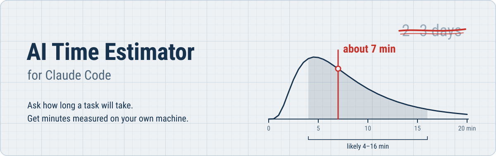
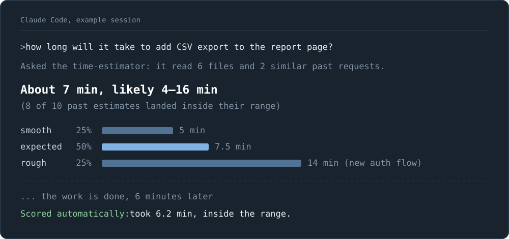

<div align="center">



</div>

<p align="center">
  <a href="LICENSE"></a>
  <a href="https://github.com/noambrand/ai-time-estimator/releases/latest"></a>
  <a href="https://github.com/noambrand/ai-time-estimator/actions/workflows/tests.yml"></a>
  
  
</p>

<h3 align="center">Ask Claude Code how long a job will take, and get a real answer in minutes.</h3>

<p align="center">
  On its own, Claude says things like "2–3 days" for work it finishes in 20 minutes. This add-on makes Claude count the work and time it with the speed of your own computer and sessions. After every job it checks how close it was, so it gets better over time.
</p>

<div align="center">



<sub>Example session (illustrative numbers)</sub>

</div>

<p align="center">
  <a href="#install-in-one-minute">Install</a> &bull;
  <a href="#what-an-answer-looks-like">What you get</a> &bull;
  <a href="#who-needs-it-and-who-doesnt">Who needs it</a> &bull;
  <a href="#how-it-works">How it works</a> &bull;
  <a href="#how-accurate-is-it">Accuracy</a> &bull;
  <a href="#privacy">Privacy</a> &bull;
  <a href="#uninstall">Uninstall</a> &bull;
  <a href="https://github.com/noambrand/ai-time-estimator/releases">Releases</a>
</p>

---

## Install in one minute

**1. In Claude Code, type:**

```text
/plugin install ai-time-estimator --marketplace noambrand/ai-time-estimator
```

**2. Start a new Claude Code session and ask:**

```text
how long will it take to add CSV export to the report page?
```

That's all. You never run anything yourself. The first time, it spends about a minute learning how fast your Claude Code is. You need Python 3.9 or newer on your computer; there is nothing else to install.

<details>
<summary>Older Claude Code, no git, or another way to install</summary>

- **Claude Code older than 2.1.275:** type `/plugin marketplace add noambrand/ai-time-estimator`, then `/plugin install ai-time-estimator@ai-time-estimator`.
- **Let Claude do it:** paste *"Install https://github.com/noambrand/ai-time-estimator for me: clone it and run its install.py"* into Claude Code.
- **From a terminal:** `git clone https://github.com/noambrand/ai-time-estimator.git && python3 ai-time-estimator/install.py` (on Windows, use `python`).
- **No git:** download `ai-time-estimator-<version>.zip` from the [latest release](https://github.com/noambrand/ai-time-estimator/releases/latest) (or the [ZIP of the main branch](https://github.com/noambrand/ai-time-estimator/archive/refs/heads/main.zip)), unzip it, and run `python install.py` in that folder.

Pick only one way. The plugin and `install.py` do the same job, so using both would score every task twice.

</details>

## What an answer looks like

You ask how long something will take. Claude answers with the minutes, the clock time they mean, and a range:

> **About 40 min (done about 15:20), likely 25–70 min (15:05–15:50), counted from 14:40.**

- If you ask about several things at once, you get one small table with a row for each and a total.
- Claude also tells you what the range depends on, and how often earlier estimates were right.
- The answer always comes in Claude's own message. You never have to open anything to read it.
- You can also type `/estimate-here <task>` to get an estimate in the current chat. Claude then waits for your go before it starts.

## Why use it

| Claude on its own | With AI Time Estimator |
|---|---|
| "This will take 2–3 days" for work done in 20 minutes | "About 7 min, likely 4–16 min" |
| A guess based on how long a person would take | A count of the work, timed with your own speed |
| Never finds out how wrong it was | Checks every estimate afterwards and learns from it |

## Who needs it, and who doesn't

A fair question: if Claude works in the background and tells you when it's done, why should you care how long it takes? Often you shouldn't. Here is when it helps, and when it doesn't.

**When it's a real need**

- **You promise a date.** A client or a manager asks when it will be ready. "About 40 minutes, likely 25–70" is a promise you can keep. Claude's own "2–3 days" is wrong by days.
- **You decide now or later.** A 10-minute job fits before a meeting. A two-hour job waits for tonight.
- **You choose what goes first.** When you know what each job costs in time, you know what to start now and what can wait.
- **Something waits for it.** The next job needs this one's result, or a demo is at three.
- **Your usage is limited.** A long job can use up your plan's limit before it ends. Its time is a rough sign of how much it will use.
- **You want to know it's stuck.** If a job runs three times longer than its estimate, Claude is probably going in circles. That is the cheapest alarm there is.
- **You want to know where your time really goes.** "Fix the slowest step next" only works if you measured the steps. Many people find that Claude's part is now the small one, and the real wait is on them: writing the request and checking the result. That is worth knowing too.

**When it's mostly peace of mind**

Sometimes you just want to know whether to wait five minutes or come back in an hour. That is not a business need, but it is not nothing: it decides whether you start something else, take a break, or stay. Knowing is calmer than guessing. Just be honest with yourself about which case you are in.

**When you can skip it**

If Claude works in the background and tells you when it's done, nothing waits on the result, nobody expects a date, and usage is not a concern, the exact minutes change nothing. Come back when you need to promise a date.

The goal is not to make Claude faster. It is to know how long it takes.

## How it works

1. **Count.** Claude looks at your project (it only reads, it never changes anything) and writes down what the job needs: how many files to read, how many edits, how many commands to run.
2. **Time.** A small script turns those counts into minutes, using how fast your Claude Code really runs. It learns that from your own past sessions.
3. **Check.** When the job is done, the add-on compares the estimate with the real time. Time you spent reading or answering does not count, and neither does time Claude only waited.
4. **Improve.** After 10 checked estimates, the ranges adjust themselves to your results.

Claude never makes up the minutes. It only counts the work, and the script does the arithmetic.

## How accurate is it?

You can test it on your own history:

```bash
python ~/.claude/ai-time-estimator/backtest.py
```

This replays your past requests and asks: how often did the real time land inside the range the estimator would have given?

On the author's computer (105 past requests it had not seen before): **the real time was inside the range 87 times out of 100.** The goal is 80.

By size of the job:

| Estimate | Requests | Real time inside the range | Real time longer than the range |
|---|---|---|---|
| under 5 minutes | 58 | 93% | 5% |
| 5–20 minutes | 35 | 86% | 0% |
| over 20 minutes | 12 | 58% | 33% |

What this means for you:

- **Trust the range more than the middle number.** The middle number is usually a bit too high: half the real times were under 60% of it.
- **Long jobs are the hardest to predict.** One slow step can stretch the whole job, so a third of the long jobs ran past the end of the range.
- **A new install is rougher at first.** It needs 10 checked estimates before it corrects itself.
- Version 1.2 mostly improved *what counts as work* when checking estimates (for example, waiting is no longer counted). So these numbers moved only a little from version 1.1 (85% to 87%).

## Privacy

Everything stays on your computer. It makes no network calls and sends nothing anywhere.

- It reads the session history that Claude Code already keeps in `~/.claude/projects/`.
- It writes only to the folder `~/.claude/ai-time-estimator/`: your speed numbers, your estimates and their scores.
- It never changes your project files.

More detail is in [PRIVACY.md](PRIVACY.md).

## What installing changes

**As a plugin:** nothing in your own settings. Claude Code loads the add-on by itself.

**With `install.py`:** it copies the add-on into your `~/.claude` folder, adds one small background check to `~/.claude/settings.json` (your old file is saved as `settings.json.bak`), and adds a short "Time estimates" note to `~/.claude/CLAUDE.md` so Claude uses the estimator whenever you ask how long something takes. Running it again just updates it. To skip the automatic checking use `--no-hook`; to leave `CLAUDE.md` alone use `--no-rule`.

## Good to know

- It depends on how Claude Code stores its session history. That format is not official and can change. If it ever stops working, the tool says `FORMAT CHECK FAILED`.
- It can only learn from as much history as Claude Code keeps (30 days by default).
- A job counts as finished when you send your next message. If Claude stops to ask you a question halfway, the check ends there.
- It measures Claude's working time only. Time you spend approving, answering or checking by hand is not part of the estimate.

## Uninstall

**Plugin:** type `/plugin uninstall ai-time-estimator`. Your history stays in `~/.claude/ai-time-estimator/`; delete that folder too if you want it gone.

**`install.py`:** from the folder you cloned or unzipped:

```bash
python install.py --uninstall           # removes the add-on, keeps your history
python install.py --uninstall --purge   # removes the add-on and your history
```

Or ask Claude Code: *"uninstall the AI time estimator by running its install.py --uninstall"*.

---

<details>
<summary><b>For developers: the technical details</b></summary>

### How the estimate is made

1. A `time-estimator` subagent inspects the repo read-only, looks up similar past requests, and writes 2–3 scenarios (smooth / expected / rough) as counts: files read, edits, lines written, command runs, fix loops.
2. `estimate.py` turns the counts into P10 / P50 / P90 minutes with a Monte Carlo simulation. The rates are measured on your machine: seconds per model turn (by model, reasoning effort and context size), the run time of each tool and shell command, output speed for long writes, and a speed spread (real ÷ predicted time of your past requests).
   - Calls that waited for your approval, or were denied, are left out of the measured rates, and so is a quick read-only command or message that took 30+ s.
   - Work started in the background (an agent, a background command) costs only its launch; its run time is shown on a separate "wall clock until the last background result" line.
   - A command with a known duration (`fixed_seconds`, or `remaining_seconds` for a job already running) is a floor the range never drops below. Long jobs you time with `estimate.py --record-job NAME SECONDS` are used by name.
3. A Stop hook (`autoscore.py`) compares each estimate with what really happened, once. Reading, answering and approving time is left out, and so is idle time waiting for background work. Work done by a background agent is measured on that agent's own transcript; work spread over several sessions is not scored unless you give an end.
4. After 10 scored estimates, the ranges correct themselves from your results and each answer carries its track record.

The answer format (minutes and clock time, a table per part, written in Claude's own reply) is added to your `CLAUDE.md` by `install.py`.

### What runs, and when

- **At session start** (plugin only), a hook runs `install.py --plugin-sync` with Python. It copies the scripts and the agent text to `~/.claude/ai-time-estimator/` and, if rates were never measured, measures them from your transcripts (about a minute). It never edits your settings or `CLAUDE.md`.
- **After each Claude turn**, a hook runs `tools/autoscore.py`. It reads that session's transcript, scores the estimates made in it, and appends the scores to `actuals.jsonl`. When your rates are a day old, it measures them again (one session at a time).
- **When you ask how long something will take**, the agent reads your project without changing it and runs `history.py`, `estimate.py`, `compare.py --report` and, when rates are missing, `calibrate.py`. What it reads stays data: a file or a past request that names a command never makes it run that command.

Files written: `rates.json`, `estimates.jsonl`, `actuals.jsonl`, `jobs.jsonl`, `autoscore.log`, all in `~/.claude/ai-time-estimator/`.

### Limits of the numbers

- The backtest measures the time model only (real counts in). How well the agent counts the work is what the automatic scoring and the self-correction track.
- Work done by a background agent is scored on that agent's transcript only when the estimate names the agent (`"worker": "agent:<name>"`) or is named after it; otherwise the asking session is measured.
- If `calibrate.py` stops recognizing model turns it prints `FORMAT CHECK FAILED`; `tools/cc_log.py` is the only file to adapt.

### Development

```bash
python -m unittest discover -s tests -v       # the tests never touch ~/.claude
python tools/backtest.py --worst 10           # accuracy on your history, with the worst misses
python tools/history.py --everywhere --grep test
python tools/estimate.py --record-job "full test suite" 280   # time a long job once; estimates then use it by name
python tools/compare.py --invalidate E2026...  # a score that measured the wrong window: kept, never learned from
python tools/compare.py --rescore              # score old rows again with the current window rules
```

Changes take effect after `python install.py`. [`.claude/CLAUDE.md`](.claude/CLAUDE.md) explains the architecture, for contributors and for Claude Code. Issues and pull requests are welcome.

### Credits

Transcript parsing follows the approach of [dioptx/cctime](https://github.com/dioptx/cctime) (MIT): streamed chunks merged by `requestId`, tool time measured from `tool_use` to `tool_result`.

</details>

## License

[MIT](LICENSE) © 2026 Noam Brand

<p align="center"><sub>If it saved you from a wrong plan, a ⭐ helps other Claude Code users find it.</sub></p>
